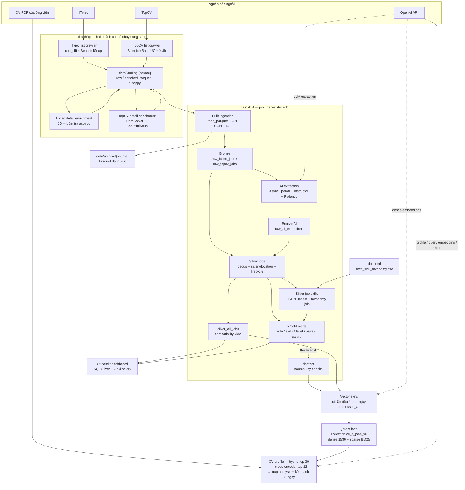
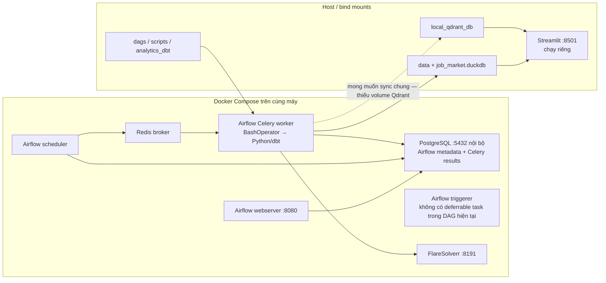
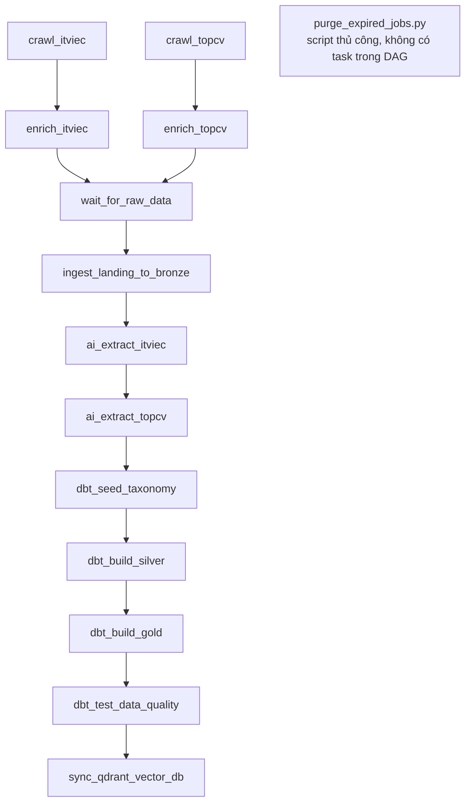
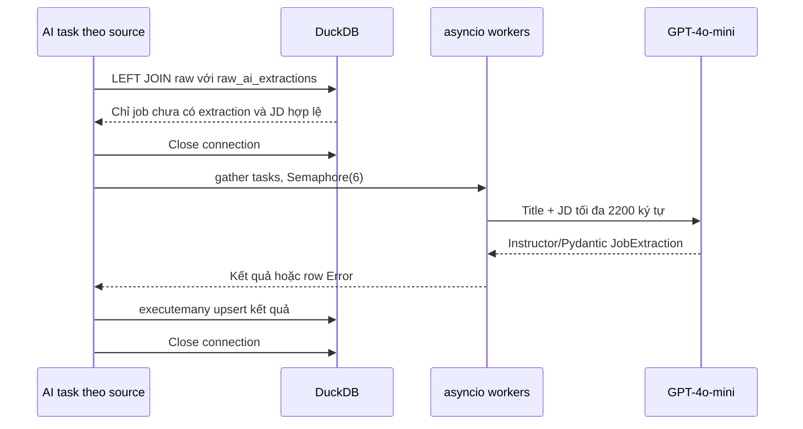
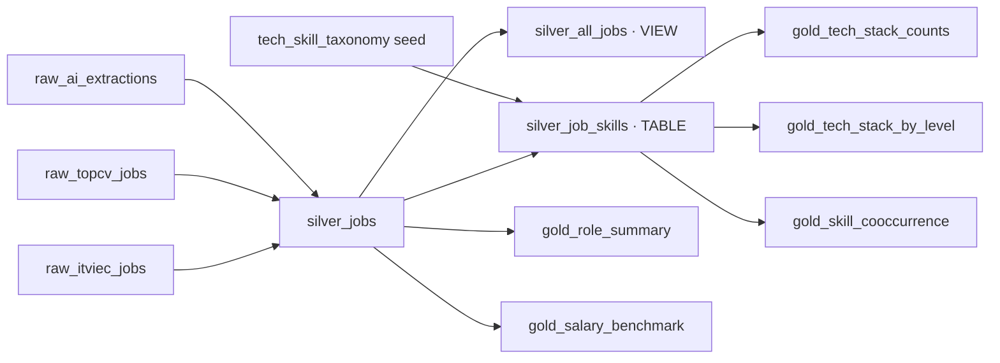

# Kiến trúc thực tế & tài liệu phỏng vấn — IT Job Market Tracker

> Tài liệu này ghi lại lần phân tích trước khi repo được refactor. Các tên script và số dòng bên dưới thuộc cấu trúc cũ. Xem [cấu trúc hiện tại](../README.md) và [bảng đối chiếu lệnh](operations.md).

Ngày phân tích: 13/10/2026. Phạm vi: source code trong repo, không chạy crawler, gọi OpenAI, rebuild dbt hay thay đổi dữ liệu. Các lỗi bên dưới được xác định bằng phân tích tĩnh; chưa phải kết quả kiểm thử tích hợp. Không đọc `.env`.

## 1. Kết luận kiến trúc

Đây là **hệ thống dữ liệu batch chạy hằng ngày, tổ chức theo Medallion trên DuckDB, kết hợp ứng dụng phân tích và RAG ghép CV với việc làm**.

Mô tả sát với implementation:

- **Ingestion:** Python crawler cho hai nguồn → Parquet landing → upsert vào DuckDB.
- **Enrichment:** LLM trích xuất thuộc tính có cấu trúc, lưu thành bảng Bronze riêng.
- **Transformation:** dbt Core dựng Silver chuẩn hóa và Gold tổng hợp.
- **Orchestration:** Airflow dùng CeleryExecutor, Redis làm broker, PostgreSQL lưu metadata và Celery results.
- **Serving:** Streamlit đọc SQL từ DuckDB; nhánh AI tìm trên Qdrant local rồi rerank và tạo báo cáo.
- **Deployment:** Docker Compose cho Airflow cùng các dịch vụ hỗ trợ; Streamlit chạy riêng trên host theo README.

Gọi đây là **local analytical platform / warehouse theo Medallion có vector serving** chính xác hơn khẳng định một lakehouse phân tán hoàn chỉnh. Repo có Parquet, nhưng không triển khai Delta/Iceberg/Hudi, object storage hay distributed compute. Medallion là cách tổ chức chất lượng dữ liệu, không tự động đồng nghĩa với lakehouse.

Về cấu trúc phần mềm, đây là một repo tích hợp gồm các script theo giai đoạn và một ứng dụng Streamlit; chưa có các domain service độc lập với API riêng. Có nhiều container hạ tầng không có nghĩa business architecture đã là microservices.

## 2. Sơ đồ tổng thể



Landing trên sơ đồ dùng chung để gọn; thực tế mỗi nguồn có raw batch và enriched batch riêng. Enricher đọc raw, ghi enriched rồi xóa raw vừa xử lý. dbt test là gate theo dependency của Airflow; không có nghĩa nó kiểm thử đầy đủ mọi Gold model.

## 3. Topology triển khai: control plane và data plane



**Điểm cần nhớ:** PostgreSQL không lưu jobs; DuckDB mới là nơi lưu dữ liệu nghiệp vụ. Redis không phải cache CV hay vector database. Celery phân phối task Airflow, còn `asyncio` nằm bên trong một task AI extraction.

Compose mount DuckDB và `data`, nhưng **không mount `local_qdrant_db`**. Sync trong worker mặc định ghi `/opt/airflow/local_qdrant_db`, trong khi Streamlit host đọc thư mục local của repo. Hai tiến trình có thể dùng hai vector store khác nhau; cần bổ sung đường dẫn/volume chung hoặc dùng Qdrant server. Chưa xác minh cấu hình runtime ngoài repo.

## 4. DAG chính xác

Nguồn: `dags/it_job_pipeline.py`.



| Thiết lập | Giá trị và ý nghĩa |
|---|---|
| Schedule | `0 7 * * *`, timezone `Asia/Ho_Chi_Minh`: 07:00 hằng ngày |
| `catchup=False` | Không tự tạo toàn bộ các lượt lịch sử từ start date |
| `max_active_runs=1` | Một DAG run hoạt động tại một thời điểm |
| `depends_on_past=False` | Task không bắt buộc run trước phải thành công |
| Retry | Một lần, cách 5 phút |
| Task implementation | `BashOperator` gọi script hoặc dbt CLI |
| Checkpoint | `EmptyOperator`, không tự kiểm tra chất lượng file |
| AI sources | Chạy tuần tự để tránh hai process cùng ghi DuckDB |

**Giới hạn của các cơ chế này:** `max_active_runs=1` không khóa script chạy tay hoặc Streamlit. Retry Airflow chỉ có tác dụng khi process trả lỗi; crawler thu được 0 jobs nhưng exit 0 vẫn có thể được tính thành công. Không thấy `execution_timeout`, SLA/freshness alert, pool riêng cho writer hoặc validation số dòng tối thiểu.

## 5. Luồng dữ liệu theo từng bước

### 5.1 Crawl danh sách và enrich JD

Hai crawler đều tìm bảy nhóm keyword: Data Engineer, Data Analyst, Data Scientist, Analytics Engineer, Machine Learning, AI Engineer và Business Intelligence. Vì vậy dữ liệu hiện tại thiên về Data/AI, dù schema cho phép nhiều role khác. Không nên giới thiệu là đã thu thập đại diện toàn bộ thị trường IT Việt Nam.

| Hạng mục | ITviec | TopCV |
|---|---|---|
| List request | `curl_cffi`, impersonate `chrome110`, cookie từ env | SeleniumBase UC, Chrome có GUI trong Xvfb |
| Parse | BeautifulSoup | BeautifulSoup từ browser page source |
| Detail request | `curl_cffi` | HTTP POST tới FlareSolverr |
| `job_id` | URL bỏ query parameters | ID số từ URL, fallback URL |
| Pagination | Tối đa 50 trang/keyword | Tối đa 10 trang/keyword |
| Dedup trong run | `set()` dùng chung các keyword | `set()` dùng chung các keyword |
| Kết thúc sớm | Trang không có cards hoặc không có job mới | Tương tự |
| Điều tiết | Random sleep | Random sleep, xoay browser mỗi 5 trang |
| File output | Parquet Snappy có timestamp | Tương tự |

ITviec list crawler thiếu cookie thì `exit()` không chỉ rõ mã lỗi; timeout request có thể retry vô hạn tại một trang. TopCV có giới hạn 10 retry. Cả hai enricher chỉ chọn **raw batch mới nhất** (`raw_files[-1]`), nên backlog file cũ có thể bị bỏ lại.

Đây là parser theo selector và chiến lược thu thập phù hợp với từng nguồn; không nên cam kết “bypass anti-bot 100%”. DOM, cookie và challenge đều có thể khiến extraction thất bại.

### 5.2 Vì sao Parquet landing?

Crawler xử lý mạng/browser lâu nhưng không giữ kết nối DuckDB. Landing tạo ranh giới giữa tác vụ I/O chậm và database writer; hai nguồn có thể crawl độc lập rồi ingestion ghi tập trung.

Parquet giữ dữ liệu dạng cột và schema, Snappy nén nhanh, DuckDB có thể đọc trực tiếp qua `read_parquet`. Trong dự án này lợi ích chính là staging theo batch và giảm tranh chấp file, không phải phân tán storage.

**Giới hạn:** landing không tự cung cấp exactly-once. Chưa có manifest, run ID xuyên suốt, checksum file, atomic rename hoặc registry ghi nhận batch đã xử lý.

### 5.3 Bronze ingestion và upsert

Nguồn: `scripts/ingest_landing_to_bronze.py`.

1. Tạo hai bảng nếu chưa có, `job_id VARCHAR PRIMARY KEY`.
2. Đọc tất cả `*_enriched_*.parquet` của từng nguồn bằng glob.
3. Insert dữ liệu mới; `first_seen_at = crawl_timestamp` ở lần insert đầu.
4. Khi trùng khóa, chỉ cập nhật `crawl_timestamp` và JD nếu JD mới không rỗng/không bằng `Connection error`.
5. Move file đã ingest sang archive; đóng connection trong `finally`.

**Hệ quả:** title, company, location, salary, tech tags của job cũ không được refresh. `JD content not found` hoặc `Error 403` vẫn có thể ghi đè JD tốt vì không nằm trong guard hiện tại.

Đây là Bronze theo **latest state/upsert**, không phải bảng raw event append-only. Lịch sử enriched batches nằm ở archive Parquet; không có SCD Type 2 hay snapshot dbt đang hoạt động.

Mỗi câu SQL và thao tác move file không nằm trong một transaction chung. Crash sau upsert trước archive dẫn đến replay. Primary key giúp tránh nhân bản ở nhiều trường hợp, nhưng không đủ để tuyên bố exactly-once; glob chứa nhiều phiên bản cùng ID cũng cần dedup đầu vào và xác định thứ tự theo timestamp.

### 5.4 AI extraction: structured output

Nguồn: `scripts/ai_extractor.py`.



Các trường trích xuất:

| Trường | Kiểu / luật |
|---|---|
| `min_years_of_experience` | Integer; prompt yêu cầu minimum thực tế |
| `core_tech_stack` | List string, tối đa 5 skills |
| `english_requirement` | Enum 4 giá trị |
| `job_role` | Literal tập role cố định |
| `job_level` | Intern/Fresher/Junior/Middle/Senior/Manager/Director/Unknown |

Validator suy level khi Unknown: 0 → Fresher, 1–2 → Junior, 3–4 → Middle, ≥5 → Senior. Đây là heuristic, không phải định nghĩa seniority đúng cho mọi công ty. YoE chưa có validation `ge=0`.

`Semaphore(6)` giới hạn số coroutine trong vùng gọi API, **không phải limiter requests/minute hay tokens/minute**. Có retry vòng ngoài 2 attempt, delay 1 giây, và `max_retries=1` của Instructor; số HTTP call thực tế còn phụ thuộc SDK. Không có exponential backoff/jitter theo quota trong code này.

Tối ưu hiện có: skip job đã trích xuất, skip các sentinel cụ thể, truncate JD, async I/O, bulk persist, không giữ DB lock trong lúc gọi mạng.

Các trade-off:

- 2200 **ký tự**, không phải 2200 token; có thể cắt mất yêu cầu cuối JD.
- Pydantic kiểm tra cấu trúc/enum, không chứng minh AI hiểu đúng nội dung.
- Không re-extract khi JD đổi vì pending query chỉ kiểm tra `a.job_id IS NULL`.
- Sau retry lỗi, vẫn insert row có `job_level='Error'`; run sau coi là đã xử lý nên không tự retry job đó.
- `asyncio.gather` gom toàn bộ kết quả rồi mới ghi; crash trước persist có thể phải gọi lại API hàng loạt.
- Cần bổ sung `jd_hash`, `prompt_version`, model/version, extraction status, retry state và checkpoint theo batch.

### 5.5 Silver: hợp nhất và chuẩn hóa

Nguồn: `analytics_dbt/models/silver/silver_jobs.sql`.

`UNION ALL` hai bảng Bronze → `ROW_NUMBER() OVER (PARTITION BY job_id ORDER BY crawl_timestamp DESC)` → lấy `rn=1` → `LEFT JOIN` AI → chuẩn hóa.

Ý nghĩa các lựa chọn:

- `UNION ALL` giữ đầu vào; dedup được thực hiện có thứ tự rõ ràng ở bước window.
- `ROW_NUMBER` chọn bản mới nhất theo key, không nhận diện hai tin giống nội dung trên hai website.
- `LEFT JOIN` giữ jobs chưa có AI; default YoE 0 và skills `[]` giúp pipeline chạy, nhưng có thể làm lệch analytics.
- Dùng `source()` cho nguồn ngoài dbt, `ref()` cho model/seed để dbt xây dependency graph.
- Role fallback bằng pattern title khi AI Unknown; một số mapping như embedded software → Backend là giả định nghiệp vụ cần đánh giá.
- Location chọn một giá trị theo thứ tự CASE; HCM/Ha Noi/Da Nang được xét trước Remote/Hybrid. Vì vậy chưa tách city và work mode thành hai chiều.

Khóa hiện tại là `job_id` toàn cục. Hai nguồn đang dùng format khác nhau nên ít dễ đụng nhau, nhưng nên chuẩn hóa key `(source, source_job_id)` hoặc surrogate key có source để tránh coupling ngầm.

### 5.6 Salary: phải nói đúng đơn vị

Macro tên `salary_*_vnd` nhưng **giá trị thực là triệu VND/tháng**, không phải VND nguyên đơn vị.

- `20 - 30 triệu` → min 20, max 30, midpoint 25.
- `1000 - 2000 USD` → khoảng 25.4–50.8 triệu với hệ số hardcode trong code: USD × 25.4 / 1000.
- `Trên 30 triệu` → min 30, max NULL; `salary_avg_vnd` dùng 30 thay vì midpoint đủ hai cận.
- Lương thỏa thuận thường thành NULL; không lương thành 0.

Hệ số trên tương đương 25,400 VND/USD do code lựa chọn, **không phải tỷ giá hiện tại đã xác minh**. Có inconsistency: currency macro nhận `$`, nhưng min/max chỉ parse nhánh có chữ `usd`. Regex chưa bao phủ mọi dấu phân cách, decimal USD hay dạng salary đơn lẻ.

`salary_avg_vnd` là midpoint của advertised range hoặc một cận, không phải lương trung bình nhân viên thật sự nhận. Gold median là median của các giá trị đại diện ấy.

### 5.7 Lifecycle: ba khái niệm khác nhau

| Trường / luật | Ý nghĩa thực tế |
|---|---|
| `first_seen_at` | Lần đầu hệ thống thấy job; không đảm bảo ngày nhà tuyển dụng đăng |
| `last_seen_at` | Bằng `crawl_timestamp`, lần list crawl gần nhất |
| `days_open`, Active | Số ngày từ first_seen tới ngày dbt rebuild |
| `days_open`, Inactive | Số ngày từ first_seen tới last_seen |
| Status Inactive | JD là `EXPIRED` hoặc crawl timestamp cũ hơn 7 ngày |

**Không nhầm “job tồn tại hơn 7 ngày” với “không được nhìn thấy 7 ngày”.** Tin tồn tại 30 ngày nhưng hôm nay còn được crawl vẫn Active. Tin được thấy lần cuối 8 ngày trước sẽ Inactive dù tuổi đời không lớn.

Silver materialize thành table, nên `CURRENT_DATE/CURRENT_TIMESTAMP` được tính khi rebuild. Nếu pipeline dừng, status và days_open không tự thay đổi theo đồng hồ. `run_ghost_task.py` chỉ query thống kê, không refresh TTL dù thông báo trong script gợi ý refresh.

### 5.8 Skills bridge và Gold marts



| Model | Grain: một row đại diện cho gì? | Kỹ thuật |
|---|---|---|
| `silver_jobs` | Một job ID sau dedup | Window, joins, macros, lifecycle |
| `silver_job_skills` | Một phần tử skill của một job | JSON → array → UNNEST; taxonomy LEFT JOIN |
| `silver_all_jobs` | Alias view của Silver jobs | Backward compatibility |
| `gold_role_summary` | Role × source | Count, average required YoE |
| `gold_tech_stack_counts` | Skill × category × source | Count distinct job ID |
| `gold_tech_stack_by_level` | Skill × category × level | Count distinct job ID |
| `gold_skill_cooccurrence` | Cặp skill không thứ tự | Self join cùng job, `skill_a < skill_b`, count ≥5 |
| `gold_salary_benchmark` | Role × level, gộp sources | Min/max, P25, median, P75, average |

`silver_job_skills` thể hiện quan hệ nhiều-nhiều theo kiểu bridge, nhưng chưa đảm bảo unique `(job_id, normalized_skill)` nếu AI lặp skill. Taxonomy chủ yếu gán category bằng exact match bỏ khác biệt hoa/thường; không phải ontology hoặc alias normalization hoàn chỉnh. Ví dụ Go/Golang vẫn có thể thống kê riêng.

Co-occurrence đếm cùng xuất hiện, **không phải correlation coefficient, causality hay association rule lift**. Top-5 skills do AI chọn khiến counts là số lần xuất hiện trong các skills được trích xuất, không phải tổng mọi skill trong JD.

Silver và Gold đều `materialized='table'`, **full rebuild mỗi run**, không có `is_incremental()`/incremental strategy trong dbt models.

## 6. Serving và RAG chi tiết

### 6.1 Vector ingestion

Nguồn: `scripts/sync_qdrant.py`.

- Collection `all_it_jobs_v6`, Qdrant **local embedded**, không có Qdrant server service trong Compose.
- Dense: OpenAI `text-embedding-3-small`, cấu hình 1536 chiều, cosine.
- Sparse: `FastEmbedSparse(model_name='Qdrant/bm25')`.
- `QdrantVectorStore(... retrieval_mode=HYBRID)`; repo ủy quyền cách fusion cho thư viện, không tự triển khai weighted sum hoặc RRF. Muốn nêu chính xác thuật toán runtime cần kiểm tra version thư viện đang cài.
- Một job là một `Document`, point ID = UUID từ MD5(job_id), giúp upsert ổn định. MD5 dùng định danh, không dùng bảo mật.
- Text embedding gồm source, title, top skills, level, YoE, English; **không chứa toàn bộ JD**, company, location hay salary trong page content.
- Company, URL, salary, role, activity, days_open... nằm trong metadata để filter hoặc hiển thị.
- Lần đầu: tất cả Active. Các lần sau: chỉ Active có `DATE(processed_at)=CURRENT_DATE`.
- Soft deactivate: flag cho point đã tồn tại; pass cuối bật flag cho Active đã tồn tại.

**Hai loại incremental khác nhau:** AI chỉ xử lý ID chưa có; Qdrant chọn ngày AI processed. Cả hai chưa là change data capture và chưa có watermark bền vững cho recovery.

### 6.2 Luồng online CV → recommendation

```mermaid
sequenceDiagram
  actor User as Ứng viên
  participant UI as Streamlit
  participant PDF as PyPDFLoader
  participant LLM as GPT-4o-mini
  participant Q as Qdrant Hybrid
  participant CE as BGE cross-encoder
  User->>UI: Upload PDF + Analyze
  UI->>UI: MD5 bytes, kiểm tra session cache
  UI->>PDF: Temporary file → load_and_split
  PDF-->>UI: Ghép page content thành cv_text
  UI->>LLM: 6000 ký tự đầu → profile JSON
  LLM-->>UI: YoE, role, primary_languages, core_skills, summary
  UI->>Q: Query role + languages + skills + summary
  Note over UI,Q: Filter metadata.is_active=true và required YoE ≤ candidate+2 hoặc NULL
  Q-->>UI: Tối đa 30 documents
  UI->>CE: Score từng cặp search_summary và document
  CE-->>UI: Top 12; lỗi thì fallback top 6 retrieval
  UI->>UI: Dedup theo job URL
  UI->>LLM: Full CV + page_content các jobs
  LLM-->>UI: Background, experience, gaps, 30-day strategy
  UI-->>User: Job cards + report; lưu st.session_state
```

**Bốn điểm dễ bị hỏi sâu:**

1. Role và tech stack chỉ được đưa vào query; không có hard filter theo role/skill. Hard filters thực tế là activity và YoE. `candidate_yoe+2` là dung sai nghiệp vụ, không phải bằng chính xác YoE ứng viên.
2. CV không được lưu thành vector/chunk để retrieval. Loader có split nhưng code ghép text lại; retrieval tìm job documents, mỗi job một vector record.
3. Candidate profile chỉ dùng prompt JSON + `json.loads`, không dùng schema Instructor/Pydantic như job extraction. Parse fail silently về fallback YoE=0, role Unknown, summary từ CV.
4. Reranker là model đánh giá cặp query-document; không retrain/fine-tune model trong repo. Report chỉ grounded vào structured job summary, không đủ toàn bộ điều khoản JD.

Dense phục vụ tương đồng ngữ nghĩa; sparse phục vụ từ/cụm kỹ thuật cụ thể. Stage retrieval lấy nhiều ứng viên để ưu tiên recall; cross-encoder chỉ tính kỹ trên tập nhỏ để cải thiện thứ tự mà hạn chế chi phí/latency. Chưa có số đo chứng minh mức cải thiện trong repo.

### 6.3 Dashboard và cache

Dashboard chủ yếu query `silver_all_jobs` trực tiếp cho overview/levels/experience/English/skills; salary dùng `gold_salary_benchmark` và một số query Silver. Không phải toàn bộ UI chỉ đọc Gold.

`st.cache_resource` cache model/client ở phạm vi resource dùng lại, không nên mô tả là mỗi user có một Qdrant instance riêng. CV report và matched jobs dùng `st.session_state`, nhận diện theo MD5 PDF bytes để tránh gọi LLM lại khi UI rerun. Cache report chưa gắn version dữ liệu jobs; kết quả có thể cũ sau khi pipeline update. Button Analyze cũng không ép chạy lại khi cùng CV đã có cached report do điều kiện hiện tại.

## 7. Data quality và tính nhất quán

### 7.1 Test đã có và chưa có

Trong `models/sources.yml` có bốn generic checks: `not_null` cho job ID của hai nguồn, `not_null` và `unique` cho AI job ID. Chưa thấy test `accepted_values`, relationship jobs-skills, salary ranges, YoE bounds, Silver uniqueness hoặc freshness trong source declarations. Thư mục tests chỉ có `.gitkeep`.

Pydantic là schema validation cho response AI, không phải dbt model contract. Repo chưa khai báo dbt `contract.enforced`.

### 7.2 Các phát hiện cần hiểu trước phỏng vấn

| Mức ưu tiên | Phát hiện trong code | Hệ quả | Hướng xử lý đề xuất |
|---|---|---|---|
| P0 | Sync cập nhật root `is_active`, search lọc `metadata.is_active` | Point inactive có thể vẫn match vì nested flag giữ True | Thống nhất một payload path cho insert/update/filter; kiểm thử active→inactive→active |
| P0 | Compose thiếu mount Qdrant local directory | Worker sync và host UI có thể dùng hai store khác nhau | Dùng Qdrant server chung hoặc mount/cấu hình cùng directory |
| P1 | Purge gọi sync trước dbt rebuild | Sync đọc Silver cũ, bỏ lỡ expired vừa ghi Bronze | Bronze update → dbt build/test → sync; kiểm tra return code |
| P1 | Qdrant incremental chỉ lấy processed_at của hôm nay | Sync lỗi hôm trước có thể bỏ sót jobs vĩnh viễn; payload freshness không được refresh | Persistent watermark/outbox; reconciliation và content/payload hashes |
| P1 | AI skip mọi ID đã có, kể cả Error | JD đổi không được cập nhật; lỗi không tự retry | Status + retry queue + jd_hash/prompt_version |
| P1 | Qdrant local có process lock | UI và sync không thể truy cập đồng thời theo cách triển khai hiện tại | Qdrant server hoặc maintenance window rõ ràng |
| P1 | DuckDB dùng chung file giữa worker và UI | Chuỗi writer trong DAG chưa giải quyết process đọc/ghi ngoài DAG | Snapshot serving/version publish hoặc tách analytical server |
| P1 | Enricher chỉ xử lý batch mới nhất | Raw backlog cũ bị bỏ lại | Xử lý danh sách pending batches với manifest |
| P1 | Ingestion không refresh salary/title/location | Báo cáo và cards lưu thuộc tính cũ | Upsert các trường có freshness policy, lưu history nếu cần |
| P2 | TTL tính trong table rebuild | Pipeline dừng thì expired status không tiếp tục đổi | Freshness alert, lịch refresh riêng hoặc runtime view có cân nhắc cost |
| P2 | Test mới tập trung Bronze IDs | Gate xanh chưa chứng minh dữ liệu serving đúng | Test Silver/Gold, business rules và retrieval integration |
| P2 | Lương có đơn vị ngầm và tỷ giá hardcode | Dễ diễn giải sai số liệu | Rename triệu VND, bảng FX có ngày hiệu lực, test parser |
| P2 | SQL UI nội suy chuỗi từ options dữ liệu | Fragile nếu dữ liệu chứa dấu nháy | Parameterized predicates |
| P2 | Dependency pin chưa chặt | Môi trường khó tái lập; app import `langchain_classic` nhưng requirements không liệt kê rõ | Lock dependencies và smoke test cài mới |

P0/P1/P2 ở đây là thứ tự ưu tiên đề xuất trong phạm vi dự án, không phải severity được đo ở production. Các phát hiện chưa được sửa trong lần phân tích này.

`purge_expired_jobs.py` chưa nằm trong DAG. Mô tả “4 tầng bảo vệ” là ý đồ thiết kế; không nên nói cả bốn tầng tự động chạy hằng ngày và đồng bộ hoàn hảo ở implementation hiện tại. AI extractor chỉ skip `EXPIRED`; status thật được tính ở Silver, không được AI ghi vào Bronze.

## 8. Trade-off: cách trả lời có chiều sâu

| Lựa chọn | Lý do phù hợp với scope hiện tại | Giá phải trả |
|---|---|---|
| Daily batch | Tin tuyển dụng không đòi độ trễ giây; dễ chạy và quản lý cost | Trễ đến lần chạy tiếp theo; TTL phụ thuộc run |
| DuckDB embedded | SQL OLAP và đọc Parquet tiện trong dự án một máy | Khó multi-process serving + writing; không tự scale cluster |
| dbt full tables | Dễ giải thích, debug và rebuild dữ liệu nhỏ | Tốn compute khi lớn; chưa có atomic publish toàn DAG |
| Bronze AI riêng | Giữ output AI qua rebuild và giảm gọi lại | Cần quản lý version/freshness/failed state |
| Parquet landing | Tách scraper khỏi DB writer, thuận tiện replay | Phải tự quản lý batches và trạng thái file |
| Qdrant local | Ít hạ tầng, thuận tiện prototype | File lock và đường dẫn/mount, không phù hợp nhiều process hiện tại |
| Hybrid + rerank | Kết hợp semantic và exact terms; rerank tập nhỏ | Thêm model, latency và nhu cầu evaluation |
| Top-5 skills | Giảm token, giữ trọng tâm | Bỏ sót skills để search và analytics |
| Soft delete | Giữ point để reactivate, tránh re-embedding chỉ vì status | Filter phải nhất quán và cần retention policy |
| Streamlit | Nhanh dựng UI data/AI | App logic tập trung, rerun/cache cần chú ý, chưa có auth/API layer |

## 9. Kịch bản failure để luyện tư duy hệ thống

**A. Crawler không thấy job do nguồn lỗi trong nhiều ngày.** Job có thể bị TTL đánh Inactive dù vẫn tuyển. Đây là heuristic freshness, không phải ground truth closure. Nên lưu `crawl_run_status`, source completeness và chỉ áp dụng absence policy sau một số lượt crawl thành công.

**B. OpenAI thành công nhưng process chết trước bulk insert.** Lần sau có thể trả phí gọi lại vì không có persisted extraction. Giải pháp: checkpoint từng batch, request/content hash, trạng thái processing/success/retryable_error.

**C. dbt Silver/Gold thành công nhưng test fail.** Airflow không chạy sync, nhưng bảng DuckDB mới đã tồn tại. UI đọc trực tiếp vẫn có thể thấy dữ liệu chưa qua gate. Muốn publish bảo đảm cần build vào schema/database version mới, test rồi switch serving version.

**D. Sync thất bại ngày thứ Hai, retry sang thứ Ba.** `processed_at = CURRENT_DATE` chọn jobs thứ Ba và có thể bỏ jobs thứ Hai. Dùng watermark thành công gần nhất, overlap window + deterministic upsert, hoặc durable outbox; đối soát missing IDs để recover.

**E. Cùng job xuất hiện ở ITviec và TopCV.** ID khác nên vẫn hai records. URL dedup UI chỉ loại cùng URL. Nếu business cần dedup cross-source phải dùng company/title/location/content similarity với ngưỡng và lưu liên kết source records, tránh merge nhầm hai vacancy khác nhau.

**F. Job 10 ngày tuổi được đánh inactive rồi active lại.** Không cần embed lại nếu nội dung không đổi; update payload activity/freshness là đủ. Code hiện tại chưa đồng bộ nested activity đúng và chưa refresh toàn bộ payload job cũ.

## 10. Nâng cấp production theo thứ tự

### Giai đoạn 1 — sửa correctness trước scale

1. Thống nhất payload path; sửa thứ tự purge; thêm purge vào DAG nếu cần daily verification.
2. Dùng Qdrant server chung; chuẩn hóa env/config và paths.
3. Thêm durable sync watermark hoặc outbox, reconcile missing vectors, retry Error extraction.
4. Ingestion cập nhật fields hợp lý; quản lý manifest batches và kiểm soát duplicate input.
5. Test các business rules và lifecycle qua đủ các lớp tới retrieval.

### Giai đoạn 2 — vận hành và đo chất lượng

- Log có run_id/source/batch_id/job_id, metrics per-stage và cảnh báo source crawl rỗng.
- Freshness: lần crawl thành công gần nhất, lần dbt publish, lần vector sync; tỷ lệ SQL Active có searchable point.
- LLM: success/retry/error rate, token usage, cost/job, accuracy role/YoE/skills trên tập JD gán nhãn.
- RAG: Recall@30 trước rerank, Precision@k hoặc nDCG@k sau rerank, tỷ lệ job inactive bị trả về, latency p50/p95 và chi phí/request.
- Đánh giá ablation dense-only/sparse-only/hybrid/hybrid+rerank trên cùng tập CV–job và nhãn relevance. Đây là phép thử đề xuất, chưa có kết quả trong repo.
- Quản lý secrets, quyền truy cập CV, giới hạn upload, cleanup temp trong `finally`, và đánh giá prompt injection từ CV/JD.
- Lock dependencies; CI compile/import smoke tests, dbt tests trên fixtures, integration test payload filter.

### Giai đoạn 3 — tăng quy mô khi số liệu chứng minh cần

- Object storage cho landing/archive; partition theo source/date/run.
- Warehouse hoặc compute phù hợp concurrency; giữ dbt models như lớp chuyển đổi nếu adapter hỗ trợ.
- Content hashes để chỉ embed/re-extract khi thay đổi, incremental transforms có xử lý late data và expiration.
- Tách serving snapshots khỏi writer; API layer/auth/queue nếu nhiều người dùng và CV analysis chậm.
- Không thêm Kafka/Spark/Kubernetes chỉ để kể stack. Chỉ chọn khi latency, volume hoặc concurrency yêu cầu.

## 11. Bài giới thiệu phỏng vấn

### Phiên bản 60–90 giây

> Em xây một nền tảng phân tích nhu cầu tuyển dụng và ghép CV với việc làm từ ITviec và TopCV. Hệ thống chạy batch hằng ngày bằng Airflow. Em tách crawler khỏi database bằng Parquet landing, sau đó ingest vào DuckDB và dùng dbt tổ chức Bronze, Silver, Gold. Một bước LLM extraction biến JD không cấu trúc thành các trường như kinh nghiệm tối thiểu, role, level và tech stack, có Pydantic kiểm tra cấu trúc.
>
> Với tính năng AI Career Coach, em tạo dense và sparse vectors cho từng job trên Qdrant. Khi người dùng upload CV, hệ thống trích xuất profile, lọc jobs theo trạng thái và kinh nghiệm, lấy 30 ứng viên qua hybrid search rồi dùng cross-encoder rerank trước khi LLM viết gap analysis và kế hoạch chuẩn bị.
>
> Phần em chú trọng là tách batch processing khỏi serving, giảm lock và API cost, quản lý freshness của tin tuyển dụng và hiểu trade-off giữa retrieval quality với latency. Phiên bản hiện tại triển khai local; em đã nhận diện các điểm cần hoàn thiện về payload consistency, recovery của vector sync và data quality trước khi mở rộng production.

Điều chỉnh “em xây/em chọn/em triển khai” theo đúng phần bạn thực sự thực hiện và giải thích được. Không nhận các phần bạn chưa làm hoặc chưa kiểm chứng.

### Phiên bản 3–5 phút: dàn ý whiteboard

1. Bài toán: JD nhiễu, hai nguồn không đồng nhất, tin hết hạn, ứng viên khó nhìn skill gap.
2. Hai use cases: market analytics và personalized retrieval/advice.
3. Vẽ sources → landing → DuckDB Bronze → AI extraction → Silver → Gold.
4. Vẽ nhánh Silver → vectors → CV query → retrieve → rerank → report.
5. Thêm Airflow, giải thích hai crawler parallel nhưng DB writers sequential.
6. Nêu một quyết định có lý do: landing giảm lock; Bronze AI giảm tái gọi API.
7. Nêu trade-off cụ thể: embedded storage phù hợp local nhưng hạn chế concurrent serving.
8. Nêu một failure case và kế hoạch đo: sync missed-day recovery, Recall@30/nDCG và freshness.

## 12. Câu hỏi kỹ thuật và mẫu trả lời

### 1. Đây là ETL hay ELT?

> Luồng chính mang tính ELT: load dữ liệu vào Bronze rồi dbt transform trong DuckDB. Trước load vẫn có scraping/enrichment JD, sau load có LLM enrichment, nên mô tả đầy đủ là batch ingestion + enrichment + warehouse transformation. Em không ép mọi bước vào một nhãn ETL/ELT.

### 2. Tại sao cần ba tầng dữ liệu?

> Bronze giữ dữ liệu nguồn và AI output, Silver thống nhất schema và business rules, Gold tổng hợp theo use case. Tách lớp giúp debug lỗi nguồn khác lỗi chuyển đổi và rebuild downstream. Bronze database hiện là latest-state; lịch sử batch ở archive, chưa phải immutable event log hoàn chỉnh.

### 3. Tại sao DuckDB thay vì PostgreSQL?

> Workload chính là đọc Parquet, aggregation và SQL analytics trong scope một máy. DuckDB giúp giảm vận hành server. PostgreSQL ở stack hiện tại phục vụ Airflow metadata. Khi nhiều process cần đọc/ghi đồng thời, em sẽ thiết kế serving snapshot hoặc chuyển storage phù hợp concurrency thay vì cố scale file embedded bằng Celery workers.

### 4. CeleryExecutor có nghĩa toàn pipeline distributed không?

> Celery phân phối task execution qua Redis, nhưng job data vẫn là file DuckDB và local Qdrant. Task runner có khả năng phân phối không đồng nghĩa data layer đã phân tán. Scale worker phải xem storage accessibility, lock và capacity từng task.

### 5. Airflow retry có đảm bảo không mất/trùng dữ liệu?

> Không. Retry chỉ chạy lại task khi process báo lỗi. Em cần operation có thể replay, keys ổn định, checkpoint và reconciliation. Repo đã dùng primary key/upsert và deterministic vector IDs, nhưng chưa có transaction xuyên SQL–filesystem–vector store hay exactly-once guarantee.

### 6. Vì sao không chạy hai AI source tasks song song?

> Trong mỗi source, API calls vẫn chạy async tối đa 6. Nhưng hai task là hai process có thể cùng ghi DuckDB file nên DAG nối tuần tự. Đây là hai mức concurrency khác nhau: process/task scheduling và coroutine I/O.

### 7. Semaphore khác rate limiter thế nào?

> Semaphore giới hạn số tác vụ đồng thời. Rate limiter giới hạn số requests/tokens trong một cửa sổ thời gian. Sáu requests rất nhanh vẫn có thể vượt requests/minute, nên production cần xử lý quota và retry/backoff riêng.

### 8. Pydantic có ngăn hallucination không?

> Nó ngăn nhiều lỗi schema và giá trị ngoài enum, nhưng output hợp lệ vẫn có thể sai nội dung. Em cần gold labels, lưu evidence spans trong JD, quality checks và metric accuracy. Job extraction dùng Instructor/Pydantic; candidate extraction hiện vẫn parse JSON thủ công và là điểm cần nâng cấp.

### 9. Dữ liệu thay đổi có được cập nhật hết không?

> Chưa. Raw upsert mới cập nhật timestamp/JD, AI không re-extract ID đã có, vector incremental chọn ngày processed_at. Em sẽ dùng content hash và model/prompt versions để tách update nội dung cần embed lại khỏi update metadata chỉ cần patch payload.

### 10. Dense, sparse và reranker khác nhau thế nào?

> Dense biểu diễn ý nghĩa tổng thể; sparse giúp các từ kỹ thuật như PostgreSQL hoặc C# có trọng lượng truy hồi. Hybrid lấy candidate pool. Cross-encoder đọc query và document cùng nhau để chấm relevance trên tập nhỏ. Nó là stage xếp hạng lại, không phải model tạo embedding cho toàn corpus.

### 11. Có dùng full CV để tìm jobs không?

> Hệ thống rút profile từ 6000 ký tự đầu, dựng query role/languages/skills/summary rồi search jobs. Full CV được đưa vào bước viết report. CV không được tạo một collection vector riêng; job document cũng chỉ là structured summary chứ chưa phải full JD.

### 12. Role và stack có hard filter không?

> Hiện chưa. Chúng đi vào query; filter cứng chỉ có active và required YoE không quá candidate+2 hoặc NULL. Nếu cần đúng role tuyệt đối, em phải normalize taxonomy và thêm payload condition, đồng thời đo tác động đến recall để tránh loại job phù hợp do AI phân loại sai.

### 13. Có dùng HNSW/RRF không?

> Repo dùng Qdrant local và LangChain hybrid abstraction, không cấu hình hoặc benchmark HNSW, cũng không tự viết RRF. Em có thể giải thích khái niệm riêng, nhưng không khẳng định implementation hiện tại dùng một thuật toán index/fusion cụ thể nếu chưa kiểm tra runtime và phiên bản thư viện.

### 14. Vì sao cần soft delete?

> Trạng thái tuyển dụng có thể đổi. Giữ vector và cập nhật flag giúp reactivate khi nội dung không đổi mà không cần embedding lại. Điều kiện quan trọng là write path và filter path thống nhất; code hiện có lệch root/nested payload mà em cần sửa trước khi cam kết không trả job expired.

### 15. Làm sao đánh giá job matching tốt?

> Tạo tập CV–job có nhãn relevance, so dense/sparse/hybrid và thêm rerank trên cùng dataset. Đo Recall@30 của retrieval, Precision@k/nDCG@k của ranking, tỷ lệ trả job inactive, p95 latency và cost. Hiện repo chưa có benchmark nên em không nêu phần trăm cải thiện không đo được.

### 16. Salary benchmark phản ánh điều gì?

> Phản ánh advertised salary đại diện cho các tin có công bố và còn active trong mẫu thu thập. Median tính trên midpoint hoặc cận có sẵn, không phải lương thực nhận của thị trường. Dữ liệu thiên Data/AI, job có salary disclosure có selection bias, và một vacancy có thể xuất hiện ở cả hai nguồn.

### 17. Dự án có data contracts đầy đủ không?

> Chưa. Có schema output AI và bốn dbt source-key checks. Em cần bổ sung accepted values, foreign-key/relationships, bounds, freshness, uniqueness ở grain Silver, và serving integration tests. Em phân biệt rõ schema validation với business correctness.

### 18. Bottleneck hiện tại là gì?

> Từ code em dự đoán browser/network scraping, LLM API và cross-encoder có thể chi phối thời gian; embedded file locks giới hạn concurrency. Đây là giả thuyết cần đo per-stage duration và p95 trước khi quyết định scale. Em không có benchmark runtime trong lần phân tích này.

### 19. Nếu tăng dữ liệu 100 lần thì làm gì?

> Trước hết đo volume, update rate và query concurrency. Tách shared Qdrant server, phục hồi sync bằng outbox/watermark, object storage cho batches, chunk/checkpoint API work và incremental dbt có xử lý lifecycle. Chỉ chuyển compute/warehouse khi số liệu vượt khả năng single-node và yêu cầu thực tế cần.

### 20. Khó nhất trong dự án là gì?

> Câu trả lời mạnh là một vấn đề có bằng chứng, chẳng hạn đồng bộ job lifecycle qua Bronze, Silver và Qdrant trong khi tránh file lock. Em trình bày symptom, nguyên nhân, trade-off và cách kiểm thử active→inactive→reactive. Nếu phần sửa chưa làm, em nói đó là vấn đề em đã phát hiện và thiết kế cách xử lý, không kể như kết quả đã triển khai.

## 13. Những câu không nên nói quá

| Tránh nói | Cách nói chính xác hơn |
|---|---|
| Enterprise-grade / production-ready | Prototype end-to-end local có orchestration và các lớp dữ liệu rõ ràng |
| Lakehouse phân tán | Medallion trên DuckDB cùng Parquet landing/archive |
| Real-time pipeline | Daily batch lúc 07:00 VN |
| Toàn bộ dbt incremental | Silver/Gold rebuild table; AI và vector có selective processing |
| Exactly-once | Upsert có thể replay một phần; chưa có end-to-end exactly-once |
| Không còn file lock | Landing và DAG giảm writer contention; serving locks vẫn tồn tại |
| Filter chính xác role và stack | Role/stack nằm trong query; activity và YoE là hard filter |
| Dữ liệu 100% active đồng bộ | Có ý đồ soft delete nhưng còn payload mismatch và recovery gaps |
| Test đầy đủ uniqueness/accepted values | Bốn source-key checks, chưa có toàn bộ business tests |
| RAG đọc toàn bộ JD | RAG dùng summary của job; JD đầy đủ chỉ ở data pipeline |
| Đã giảm 87% requests | Chỉ verify jobs days_open≥7; tỷ lệ tiết kiệm phụ thuộc dữ liệu, chưa xác minh metric |
| Reranking tăng accuracy X% | Có stage rerank; cần evaluation để biết mức cải thiện |

## 14. Checklist ôn tập và code map

Trước phỏng vấn, tự làm được: vẽ hai luồng offline/online không xem tài liệu; giải thích grain mỗi bảng; theo dõi một job từ URL tới recommendation; phân biệt freshness với age; trình bày failure sync qua ngày; giải thích semaphore/rate limit và schema/semantic correctness; nói rõ những gì đã đo và chưa đo.

| Chủ đề | File nên mở để giải thích |
|---|---|
| Dependencies và schedule | `dags/it_job_pipeline.py:26` |
| Celery / Postgres / Redis / volumes | `docker-compose.yaml:31` |
| Ingestion và first_seen | `scripts/ingest_landing_to_bronze.py:54` |
| Pending AI selection | `scripts/ai_extractor.py:69` |
| Schema và level heuristic | `scripts/ai_extractor.py:97` |
| Async và concurrency | `scripts/ai_extractor.py:140` |
| SQL dedup/AI join/lifecycle | `analytics_dbt/models/silver/silver_jobs.sql:6` |
| JSON skills và taxonomy | `analytics_dbt/models/silver/silver_job_skills.sql:6` |
| Salary macros | `analytics_dbt/macros/parse_salary.sql:1` |
| dbt checks thực tế | `analytics_dbt/models/sources.yml:1` |
| Collection và vectors | `scripts/sync_qdrant.py:35` |
| Incremental vector selection | `scripts/sync_qdrant.py:96` |
| Payload soft delete | `scripts/sync_qdrant.py:82` |
| CV profile và filter | `app.py:433`, `app.py:491` |
| Retrieval/rerank/report | `app.py:511`, `app.py:525`, `app.py:543` |
| Purge ordering | `scripts/purge_expired_jobs.py:180` |

Các file maintenance không phải luồng chính: `cleanup_jobs.py`/`market_insight.py`/`run_ghost_task.py` là thống kê; `check.py` và `reset_silver_layer.py` có thao tác xóa bảng; `generate_cv.py` thực tế inspect Qdrant, không tạo CV; `inspect_db.py` inspect DuckDB bằng relative path; `convert_svg.py` là tiện ích docs có đường dẫn cá nhân hardcode. Không chạy các script này chỉ để xem kiến trúc.
